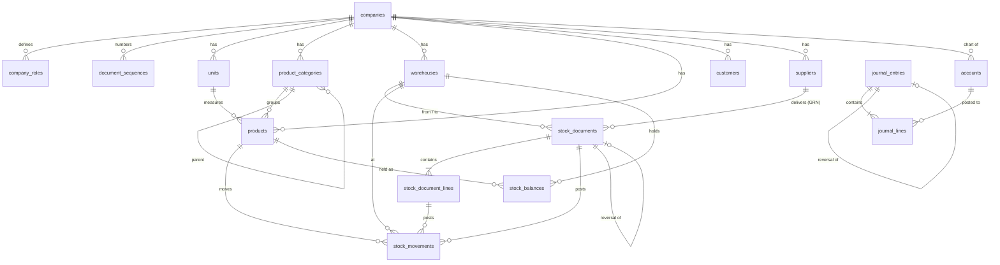

# Universal ERP, architecture, data model and rules

VouchFlow is growing from a voucher-approval product into a Universal ERP: one core
platform, one Laravel API, one MySQL database, with modules a company switches on to
match its business. This document describes what exists today (Phase 1 core), the
contracts later phases build on, and the rules that hold the books straight.

The phased plan, effort and risks are in [ROADMAP.md](ROADMAP.md).

---

## 1. Architecture

```
Next.js (web) ─┐                         ┌─ VouchFlow  (vouchers, workflows, payments)  - live
               ├─→ Laravel REST API ─────┼─ ERP core   (config, roles, inventory,        - live, Phase 1
Flutter (app) ─┘     Sanctum · tenancy   │              parties, accounting)
                     policies · services └─ Phases 2–6 (production, dispatch, fleet, HR…), planned
                           │
                        MySQL (one database, many tenants)
```

**Module boundaries.** Every ERP module lives under its own namespace and talks to the
others only through services, never by writing another module's tables:

| Layer | Location | Rule |
| --- | --- | --- |
| Models | `backend/app/Models/Erp/` | Tenant-owned models use `BelongsToTenant`. Ledger models refuse updates and deletes. |
| Services | `backend/app/Services/Erp/` | The only code that changes stock or the ledger. Every posting runs in one DB transaction with the affected rows locked. |
| Config | `backend/app/Support/Erp/` | `BusinessConfig` (what a company runs), `BusinessTemplates` (starting points), `Permissions` (catalogue + role defaults). |
| HTTP | `backend/app/Http/Controllers/Api/Erp/` | Validation and response shape only. Each route declares `module:` and `permission:` middleware. |
| Web | `web/app/(app)/erp/`, `web/lib/erp.ts` | Renders what the API allows; hides what the caller's resolved permissions withhold. |

**Cross-module integration** (Phase 2 onwards) happens by *reference*, never duplication:
a GRN points at its purchase order, a payment voucher points at the supplier invoice it
pays, and the journal entry points at whichever document posted it
(`journal_entries.source_type/source_id`). Each fact is stored once.

### Tenancy and access, in three layers

1. **Tenant scope**, every tenant-owned query is constrained to the caller's company in the
   query layer, and fails closed. Another company's record is a 404, not a 403.
2. **Module gate**, `module:inventory` refuses a module the company has not switched on,
   with a message saying so (`code: module_disabled`).
3. **Permission gate**, `permission:inventory.post` checks the caller's role, as the company
   has configured it.

A company that has not run Business setup has VouchFlow only. Existing tenants see no change
until their administrator opts in.

---

## 2. Data model (Phase 1)



| Table | Purpose | Key guarantees |
| --- | --- | --- |
| `companies` (+4 columns) | `business_type`, `modules`, `erp_settings`, `setup_completed_at` | Read only through `BusinessConfig`, which owns the defaults. |
| `company_roles` | A tenant's own role definitions and re-scoped built-in roles | `unique(company_id, key)` |
| `document_sequences` | Per-company, per-prefix, per-year numbering | Row locked while a number is issued. |
| `units`, `product_categories`, `warehouses` | Catalogue and places | Unique codes per company. A warehouse with history cannot be deleted. |
| `products` | SKU, barcode, type, unit, prices, reorder level, batch/expiry/serial tracking, `custom_fields` | Unique SKU per company. A product with history is deactivated, never deleted. Tracking cannot change while stock is on hand. |
| `stock_documents` / `_lines` | Opening, GRN, issue, transfer, adjustment, count | Nothing moves while `draft`. Posted documents are immutable; corrections are reversal documents. |
| `stock_movements` | The inventory ledger | Append-only (model refuses update/delete). `unique(line, type, warehouse)` stops a line posting twice. Records who, when, reference, reason and running balance. |
| `stock_balances` | Running quantity and weighted average cost per product, place and batch | Written only by `StockLedger`, under `lockForUpdate`, alongside the movement that explains it. |
| `customers`, `suppliers` | Parties; credit limit, prepayment flag and terms; bank details | Soft-deleted, so history keeps resolving. |
| `accounts` | Chart of accounts; `system_key` lets the posting rules find accounts however a company renumbers them | System accounts cannot be deleted or deactivated. An account with postings keeps its type. |
| `journal_entries` / `_lines` | Double-entry general ledger | Balanced to the cent before writing. `unique(company, source_type, source_id, purpose)` stops a document posting twice. Immutable except posted → reversed. |

Every financial and inventory row carries: unique identifier, company, source document,
transaction date, the user who initiated it, the user who approved/posted it, status, and an
audit-log entry (`audit_logs`). Creation, posting and transaction dates are separate columns.

---

## 3. Inventory rules

- **Stock moves only at posting.** Preparing a document and posting it are separate
  permissions (`inventory.receive` … vs `inventory.post`).
- **Exactly once.** Posting locks the document row, re-checks it is still a draft, writes
  every line and the journal in one transaction. A second post is refused (422), and the
  database's unique keys refuse it again if two requests race.
- **No negative stock** unless the company's policy (`allow_negative_stock`) says otherwise.
  The refusal names the product, place, quantity on hand and quantity needed, and leaves no
  trace.
- **Weighted average cost.** Receipts re-weight the average; issues and transfers leave at it;
  a transfer arrives at the cost it left at; a reversal takes stock back out at the cost it
  came in at.
- **Counts post only the variance**, and record what the system held at the moment of posting.
- **Tracking is enforced:** batch numbers for batch-tracked products, expiry dates on inbound
  stock for perishables, one serial per line for serial-tracked items, whole numbers for units
  that do not allow fractions.

## 4. Accounting posting rules

Posted automatically when the **accounting** module is on. Amounts are the movements' value
at weighted average cost.

| Document | Debit | Credit |
| --- | --- | --- |
| Opening stock | 1400 Inventory | 3900 Opening balance equity |
| Goods received (GRN) | 1400 Inventory | 2150 Goods received not invoiced |
| Stock issue | 5200 Stock issued to operations | 1400 Inventory |
| Adjustment / count, gain | 1400 Inventory | 5300 Inventory adjustments |
| Adjustment / count, loss | 5300 Inventory adjustments | 1400 Inventory |
| Transfer |, no entry: value stays on 1400 | |
| Reversal of any of the above | The mirror image, linked by `reversal_of_id` | |
| Manual journal | As entered; must balance | |

GRNI (2150) is the bridge to Phase 2 procurement: when the supplier invoice is matched, it
clears GRNI against Accounts payable (2100), and the VouchFlow payment voucher clears payable
against bank or cash. Each document posts its own entry once; none re-posts another's.

## 5. Role & permission matrix (defaults)

A company can re-scope any built-in role and create its own (**Roles & permissions**). The
company administrator always holds everything. Approving, signing and paying vouchers is set on
each workflow step, not by these permissions.

| Permission | CEO / Director / Auditor | Finance | Accountant | Cashier | Procurement | Warehouse mgr | Storekeeper | Sales | Production mgr | Dispatch | HOD / Manager |
| --- | :-: | :-: | :-: | :-: | :-: | :-: | :-: | :-: | :-: | :-: | :-: |
| inventory.view | ✓ | ✓ | ✓ | | ✓ | ✓ | ✓ | ✓ | ✓ | ✓ | ✓ |
| inventory.manage | | | | | | ✓ | | | | | |
| inventory.receive | | | | | ✓ | ✓ | ✓ | | | | |
| inventory.issue / transfer / adjust | | | | | | ✓ | ✓ | | issue | | |
| inventory.post / reverse | | | | | | ✓ | | | | | |
| customers.view | ✓ | ✓ | ✓ | ✓ | | | | ✓ | | ✓ | mgr |
| customers.manage | | ✓ | | | | | | ✓ | | | |
| suppliers.view | ✓ | ✓ | ✓ | ✓ | ✓ | ✓ | | | | | mgr |
| suppliers.manage | | ✓ | | | ✓ | | | | | | |
| accounting.view | ✓ | ✓ | ✓ | | | | | | | | |
| accounting.post | | ✓ | ✓ | | | | | | | | |
| accounting.manage / reverse | | ✓ | | | | | | | | | |
| erp.configure / roles.manage | admin only | | | | | | | | | | |

HR Manager, Fleet Manager, Driver and Employee hold no ERP permissions until their modules ship
(Fleet Manager has inventory/supplier view for parts). A platform super admin inspecting a
tenant gets view-only access, recorded in the audit log.

---

## 6. Business templates

`general`, `manufacturing`, `beverage`, `wholesale`, `retail`, `supermarket`, `pharmacy`,
`spare_parts`, `electronics`, `clothing`, `hardware`, `hospitality`, `transport`,
`petrol_station`, `financial_agent`. Each pre-fills recommended modules, units, categories,
extra product fields (e.g. part number and compatible models for spare parts; generic name and
strength for pharmacy) and default tracking. Applying a template again only adds what is
missing.

---

## 7. API (Phase 1)

All under `/api/erp`, Sanctum bearer token, tenant resolved from the user.

| Area | Endpoints |
| --- | --- |
| Setup | `GET templates` · `GET config` · `GET overview` · `POST setup` · `PUT config` |
| Roles | `GET roles` · `POST roles` · `PUT roles/{key}` · `DELETE roles/{key}` |
| Catalogue | `units`, `categories`, `warehouses`, `products`, index/show/store/update/destroy |
| Stock | `GET stock/balances` · `GET stock/movements` · `GET stock/alerts` · `GET stock/valuation` |
| Documents | `GET/POST stock-documents` · `GET/PUT stock-documents/{id}` · `POST …/{id}/post` · `POST …/{id}/reverse` · `POST …/{id}/cancel` |
| Parties | `customers`, `suppliers`, index/show/store/update/destroy |
| Accounting | `GET/POST/PUT/DELETE accounts` · `GET/POST journals` · `GET journals/{id}` · `POST journals/{id}/reverse` · `GET trial-balance` |

Domain refusals return **422** with a sentence written for the person on screen; a module that
is off returns **403** `module_disabled`; a missing permission returns **403** naming it.

---

## 8. Acceptance criteria, status

| # | Criterion | Status | Held by |
| --- | --- | --- | --- |
| 1 | Stock rises after a confirmed GRN | **Done** | `ErpInventoryTest::test_stock_rises_only_once_a_grn_is_posted` |
| 2 | Stock falls after an approved issue, never twice | **Done** | `…test_an_issue_reduces_stock_once_and_refuses_to_go_negative`, `…test_a_document_cannot_be_posted_twice` |
| 3 | A sales order cannot load without stock | Phase 2 (ledger refusal it relies on is done) | |
| 4 | Prepayment orders wait for payment verification | Phase 2 (`customers.requires_prepayment` exists) | |
| 5 | Credit customers proceed only within policy | Phase 2 (`credit_limit`, terms exist) | |
| 6 | Loading order ↔ loaded qty ↔ delivery note | Phase 2 | |
| 7–8 | Transport costs on trips; hired vehicles not double-counted | Phase 3 | |
| 9 | Purchase invoice and payment without duplicate posting | Phase 2 (source-keyed journals are done) | |
| 10 | Payroll ↔ payslips ↔ journals | Phase 4 | |
| 11 | A rejected voucher cannot be paid | **Done** (VouchFlow) | existing `ApprovalWorkflowTest` |
| 12 | HOD signature and CEO approval are separate steps | **Done** (VouchFlow) | existing `ApprovalWorkflowTest`, `PolicyTest` |
| 13 | Unauthorised users cannot see HR, finance or another company | **Done** for finance and tenancy | `ErpAccessTest::test_people_without_finance_permissions_cannot_read_the_ledger`, `…another_companys_erp_records_are_invisible_and_unusable` |
| 14 | Posted entries balance | **Done** | `ErpAccessTest::test_a_manual_journal_must_balance_and_reverses_cleanly`, `ErpInventoryTest::test_posting_writes_a_balanced_journal_for_each_stock_document` |
| 15 | Reports agree with stored transactions | **Done** for stock and the ledger | `…test_weighted_average_cost_follows_each_receipt`, `…reversing_a_grn_…` |

## 9. Demo

`php artisan migrate:fresh --seed` sets Watercom up as a beverage factory: three stores,
seven products from preforms to finished cartons, three suppliers, five customers, and a month
of posted stock history (opening balances, two GRNs, a depot transfer, a production issue, a
damage adjustment) plus one GRN left in draft for a warehouse manager to post. Password for
every demo account: `Password123!`.

| Person | Email | Role |
| --- | --- | --- |
| Neema Shirima | admin@watercom.test | Company administrator, everything |
| Peter Lema | peter@watercom.test | Warehouse manager, posts stock documents |
| Neema Swai | neema@watercom.test | Storekeeper, prepares, cannot post |
| Grace Mushi | grace@watercom.test | Accountant, ledger and manual journals |
| Hassan Juma | hassan@watercom.test | Salesperson, customers |
| Upendo Kimaro | upendo@watercom.test | Procurement officer, suppliers, GRNs |
